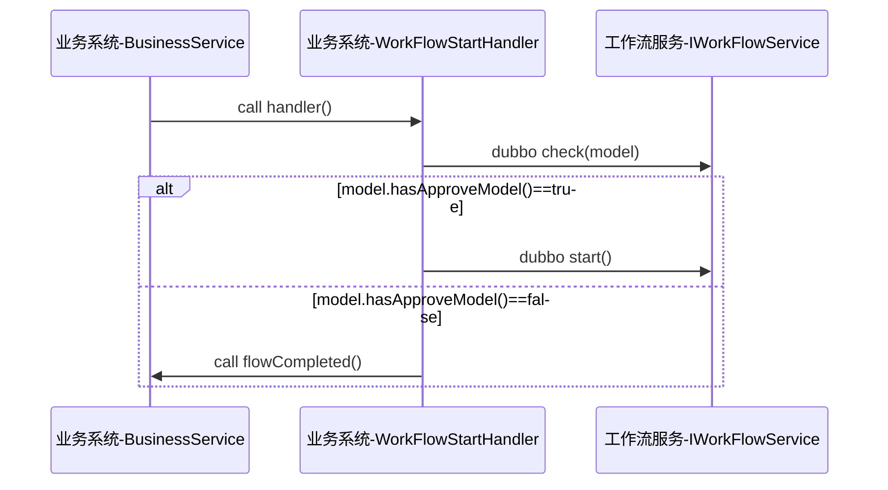
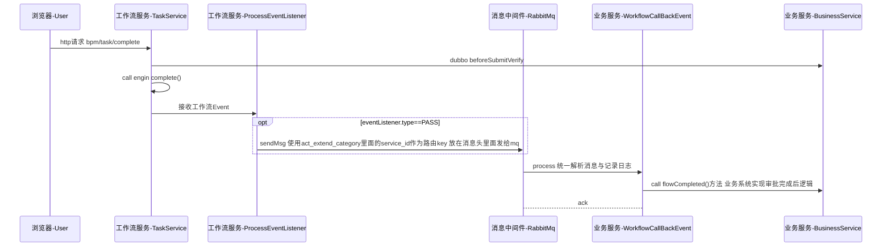

### 工作流服务概述

**定位**：独立的「流程引擎中台」服务——负责流程**模型设计/部署、流程实例启动、任务审批、撤回、转授、历史查询**，
并通过回调契约把审批结果接力回各业务微服务；**业务页面与业务数据由业务系统提供**，任务审批入口由工作流服务统一处理。
对外以 `com.bytter.core.bpm.context.WorkFlowStartHandler` 与 `IWorkFlowService` 契约被各业务服务调用，
消费 bytter-system（单位/用户/通知/币种/菜单/配置/多语言）。

#### 代码分层

```
- bytter-workflow

    - bytter-workflow-adapter

      适配层对应mvc的controller层使用web|mobile|wap按包名隔离，vm资源存放此层
      （web/controller 与 web/saas 双入口、mobile/ 移动端审批）

    - bytter-workflow-client

      定义暴露的api接口给其他服务调用（IWorkFlowService、IFlowCategoryService、IOptionService、
      IWorkFlowTaskCompletedListener）与 dto / enums / constant

    - bytter-workflow-domain

      主要业务处理接口实现、数据库访问与数据组装后续DDD改造升级重点重构模块
      （bpm 契约与注册、listener Camunda 事件监听、service 编排、entity/mapper 扩展表）

  （本服务**没有 -start 模块**，与其它 bytter-* 服务的四模块结构不同）
```

#### 流程引擎与涉及表

1. 使用Camunda 7.18版本
官方文档地址 https://docs.camunda.org/manual
2. 流程引擎自身引入表脚本

删除脚本 [mysql_engine_7.18.0_drop.sql](bytter-workflow-domain/src/main/resources/sql/mysql_engine_7.18.0_drop.sql)

新增脚本 [mysql_engine_7.18.0_create.sql](bytter-workflow-domain/src/main/resources/sql/mysql_engine_7.18.0_create.sql)

前缀,全称,作用描述
ACT_RE_*,Repository,存储“静态”资源。包含流程定义、部署包、流程图 XML 等。
ACT_RU_*,Runtime,存储“动态”运行数据。流程在执行时的状态、任务、变量，流程结束后，此中数据会被删除。
ACT_HI_*,History,存储“历史”数据。已完成的流程、任务快照、操作日志，用于审计和报表。
ACT_GE_*,General,存储“通用”数据。如二进制大对象（变量附件）、系统属性。
ACT_ID_*,Identity,存储“身份”数据。用户、用户组、租户以及它们之间的映射关系。

> 引擎表共 **43 张**（依据 `mysql_engine_7.18.0_create.sql`；另有 `mysql_identity_7.18.0_create.sql` 身份表脚本），
> 属框架自建表，**不画入 ERD**（ERD 只覆盖本服务业务表，见下）。

3. 工作流自定义扩展表

初始化脚本[mysql_extent_drop_create.sql](bytter-workflow-domain/src/main/resources/sql/mysql_extent_drop_create.sql)

act_extend_category
: 流程分类表 业务流程分类key 回调服务和审批业务地址及是否审批等配置

act_extend_model
: 流程模型表 存储流程的bpmn数据和是否支持撤回等配置

act_extend_delegation act_extend_delegation_rel
: 流程转授表 处理流程转授相关业务

act_extend_option
: 流程配置表 主要配置业务流程走向的扩展条件

act_extend_msg_record
: 工作流消息发送后 日志记录表

#### 领域业务表（8 张进 ERD）

| 分组 | 表名 | 中文说明 | 载体 |
|---|---|---|---|
| 流程配置 | ACT_EXTEND_CATEGORY | 流程分类表 | MyBatis-Plus 实体 `FlowCategory`（`@TableName`）+ 扩展表 DDL |
| 流程配置 | ACT_EXTEND_MODEL | 流程模型表 | MyBatis-Plus 实体 `FlowModel` |
| 流程配置 | ACT_EXTEND_OPTION | 流程配置表 | MyBatis-Plus 实体 `FlowOption` |
| 流程配置 | BPM_OPTION | 流程单据配置表（旧） | JPA 实体 `Option`（`@Table`）；**旧表**，相关 DAO 代码已整体注释 |
| 转授与消息 | ACT_EXTEND_DELEGATION | 流程转授表 | MyBatis-Plus 实体 `FlowDelegation` |
| 转授与消息 | ACT_EXTEND_DELEGATION_REL | 流程转授关联表 | MyBatis-Plus 实体 `FlowDelegationRel` |
| 转授与消息 | ACT_EXTEND_MSG_RECORD | 工作流消息记录表 | MyBatis-Plus 实体 `FlowMsgRecord` |
| 运行日志 | WORKFLOW_BUS_ERROR_LOG | 工作流业务错误日志表 | JPA 实体 `WorkFlowBusErrorLog`（`@Table`） |

> 关系（5 条，2 observed + 3 inferred）：`ACT_EXTEND_DELEGATION_REL.DELEGATION_ID → ACT_EXTEND_DELEGATION.ID`
> （`FlowDelegationMapper.xml:8` join）、`ACT_EXTEND_OPTION.CATEGORY → ACT_EXTEND_CATEGORY.ID`（`FlowOptionMapper.xml:8` inner join）；
> `ACT_EXTEND_MODEL.CATEGORY_ID → ACT_EXTEND_CATEGORY.ID`、`ACT_EXTEND_DELEGATION_REL.CATE_ID → ACT_EXTEND_CATEGORY.ID`、
> `ACT_EXTEND_MSG_RECORD.CATE_KEY → ACT_EXTEND_CATEGORY.CATE_KEY`（列名推断）。
> ⚠️ 本服务**没有 `sql/oracle` DDL**，表结构以 `resources/sql/mysql_extent_drop_create.sql` 与实体注解为准；
> 其中 6 张 `@TableName` 表因**扫描器只识别 JPA `@Table`** 而需手工补入账本（带 note 标记）。

#### 业务启动流程

业务系统统一调用com.bytter.core.bpm.context.WorkFlowStartHandler.handler 启动共5个参数
* cateKey 流程分类key 对应act_extend_category表里面的cate_key
* businessKey 业务ID 一般对应启动流程审批业务主键
* variables 流程变量 需要传输给流程的条件参数或者其他手机端展示字段
* corpId 单位ID
* userId 启动流程的用户ID



#### 工作流审批调用流程

审批统计工作流统一处理 业务审批展示页面与数据查询业务系统处理 任务审批入口工作流服务统一处理

工作流与业务回调采取消息通知方式，共用一个交换机名称workflow-mq-direct
每个微服务绑定一个queue接收消息 使用微服务名作为queue名称 微服务多个实例用同一个group 保证只有一个实例收到消息 自动确认



#### 审批分支、转授与兜底（本轮审读补充）

| 环节 | 行为与分支 | 证据 |
|---|---|---|
| 发起 | `WorkFlowStartHandler.handler` → `hasApproveModel`；**无审批模型**时直接回调业务 `flowCompleted(PASS)` 并写 `act_extend_msg_record`（状态 `AUTO`） | `bpm/context/WorkFlowStartHandler.java:47,73-79,103` |
| 审批提交 | `bpm/task/complete` → 仅「通过」时先 `beforeSubmitVerify`（Dubbo 调业务 `submitVerify`）→ 引擎 `taskService.complete` | `WorkFlowServiceImpl.java:320,333,367` |
| 分支 | `workflowPass`：`PASS 1` 推进 / `REJECT 3` 打回上一节点（多实例补 `#multiInstanceBody`）/ `REJECT_START 4` 打回制单处并终止实例 | `WorkFlowServiceImpl.java:355-379,433,514` |
| 结束回调 | Camunda 结束事件 → 读 `taskPassFlag`（可回退查历史变量）→ 按 cateKey 取业务监听器 → `flowCompleted`；网关直连结束节点时置 PASS、userId=`bpmAuto` | `listener/ProcessEventListener.java:70,110-140` |
| 撤回 | 三重校验（模型可撤回 / 撤回人=发起人 / 无人审批过）→ 置 `taskPassFlag=RK` 并删实例 | `WorkFlowServiceImpl.java:551,583-618` |
| 转授 | 转授单 暂存→待生效→生效→结束；`@XxlJob("DelegationService")` 扫描已生效转授，把未审批任务改派给被转授人 | `FlowDelegationService.java:73-158,346-358,129` |
| 兜底重试 | `WorkFlowCompletedListenerAspect` 环绕 `flowCompleted`，异常落 `WORKFLOW_BUS_ERROR_LOG`；`WorkFlowRetryHandler.retry` 依记录重放 | `WorkFlowCompletedListenerAspect.java:47-66`；`WorkFlowRetryHandler.java:27-52` |

#### 状态与枚举

- **审批结果** `WorkFlowResult.ApprovalStatus`：`PASS(1) 通过` / `RK(2) 撤回` / `RJ(3) 打回上一节点` / `RJS(4) 打回制单处`（流程变量名 `taskPassFlag`）。
- **转授状态** `DelegationStatusEnum`：`STORAGE(1) 暂存 → WAIT(2) 待生效 → SURE(4) 生效 → FINISH(5) 结束`（`REJEC(3) 打回`）。
- **模型状态** `FlowModel.Status`：`STOP(0) 停用 / START(1) 启用`；模型另有 `revokeAble` / `batchRevokeAble` / `mustApprove` 开关。
- **消息记录** `MsgRecordStatus`：`UN_SEND(0) / SEND(1) / ACK(2) / UCK(3) / AUTO(4 自动通过)`。
- **流程分类类型** `FlowCategoryConstant`：`1 审批流程 / 2 业务流程`。

#### 接口能力与依赖

- **业务接入契约（client 模块）**：`com.bytter.workflow.api.IWorkFlowService`（启动 `start`、完成 `complete`、撤回 `batchRevoke`、查询）、
  `IFlowCategoryService`、`IOptionService`、`IWorkFlowTaskCompletedListener`（任务级回调）。
- **回调契约（domain.bpm）**：`IWorkFlowListener` 聚合 `IWorkFlowStartedListener.flowStarted`、`IWorkFlowCompletedListener.flowCompleted`、
  `IWorkFlowRevokeListener.flowRevoke`、`IWorkFlowSubmitVerifyService.submitVerify`；业务侧以 `@WorkFlow(cateKey)` 标注实现类，
  由 `WorkFlowListenerRegistrar` 扫描注册进 `WorkFlowHelper`；工作流→业务以 **Dubbo group=cateKey** 动态引用业务监听器。
- **本服务导出**：源码内**未见 `@DubboService`**（业务侧多以内嵌 `IWorkFlowService` 注入使用）。
- **本服务消费（`com.bytter.system.api`）**：`ICorpService`、`IUserService`、`INotificationService`、`IBtCurrencyService`、
  `IMenuService`、`IConfigService`、`Ii18nService`；启动/审批/撤回后 `broadcastMessage(HOME_NOTICE)` 推站内通知。
- **MQ**：设计为交换机 `workflow-mq-direct`、queue=微服务名、routingKey=`act_extend_category.service_id`、自动确认（见上文时序图）；
  `FlowMessageService` 已注入 `StreamBridge`，但**本仓库未见实际 `send` 调用与消费者实现**（消费者在各业务服务的 `WorkflowCallBackEvent`）。
- **定时任务（1 个）**：`@XxlJob("DelegationService")` → 转授生效扫描与任务改派。
- **业务侧典型实现方**：`bytter-system` 的 `BtBankAccFreezeService`（账户冻结，`@WorkFlow(netbankBankaccFreeze)`）、
  `bytter-service-payment` 的 `NisWageService` / `CgsBillService` / `TpPaymentService` 等，以及 `bytter-prepose-*` 各审批单据。

#### 域边界与注意

- **引擎表 vs 业务表**：43 张 `ACT_*` 引擎表由 Camunda 自建脚本维护，**不画入 ERD**；ERD 只含本服务 8 张业务表（6 张扩展表 + 2 张自有表）。
- **扫描取证注意**：`scan_jpa_ledger.py` **只识别 JPA `@Table`**，对 MyBatis-Plus `@TableName` 不识别——本服务 6 张扩展表即因此需按实体注解与扩展表 DDL 手工补入账本（`note` 已标记「账本扫描不产出」，重扫会丢）。
- **本服务无 sql/oracle DDL**：`sql/` 目录下无本服务脚本，表结构以 `resources/sql/*.sql` 为准。
- **旧表**：`BPM_OPTION`（旧单据配置）相关 DAO 代码已整体注释，仅保留实体；迁移时应以后续 `act_extend_option` 为准。
- **跨服务耦合**：工作流对 `netbankAllocation*` / `cmsloan*` 分类做了前置校验合并（资金调拨、小微贷款特判），与 bytter-service-payment 业务耦合。

#### 交付图（`tools/service-db-diagram/work/`）

| 图 | 主题 | 说明 |
|---|---|---|
| `workflow_erd.png` | bytter-workflow•工作流引擎•数据库表关系图 | 8 表 / 5 边（3 个业务分组：流程配置 4 / 转授与消息 3 / 运行日志 1；引擎 43 表不画） |
| `workflow_business_flow.workflow.tables.html` | 流程引擎（审批中台）主流程 | 7 节点 / 17 表引用（交互式节点×表透镜） |

渲染源见 `tools/service-db-diagram/sources/workflow/`（账本 + `*.workflow.json` + 节点×表 map + 分组 JSON + 规格文件）。
